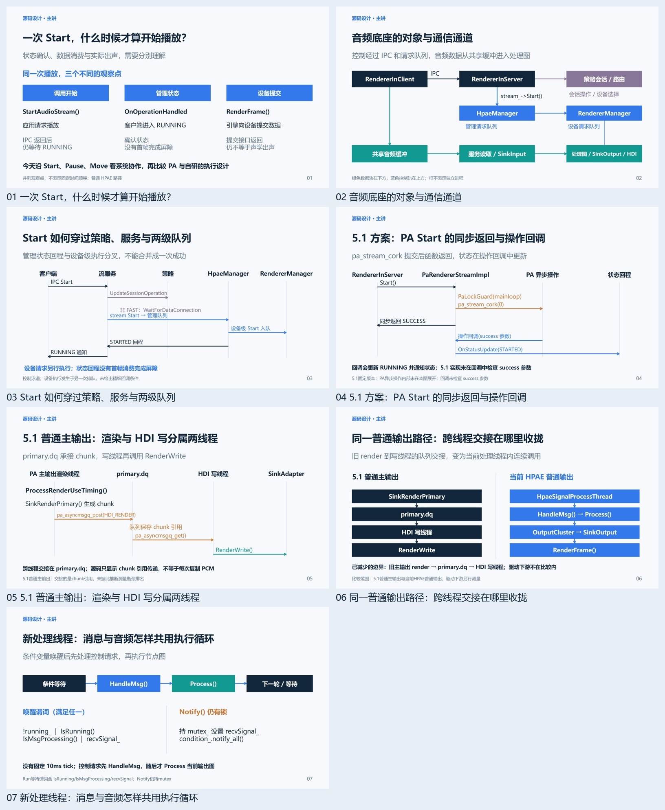
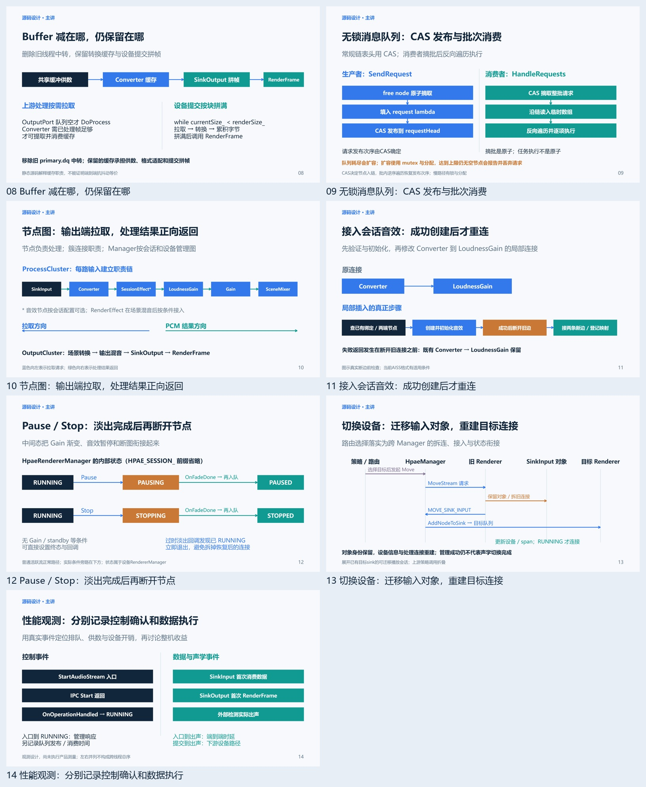
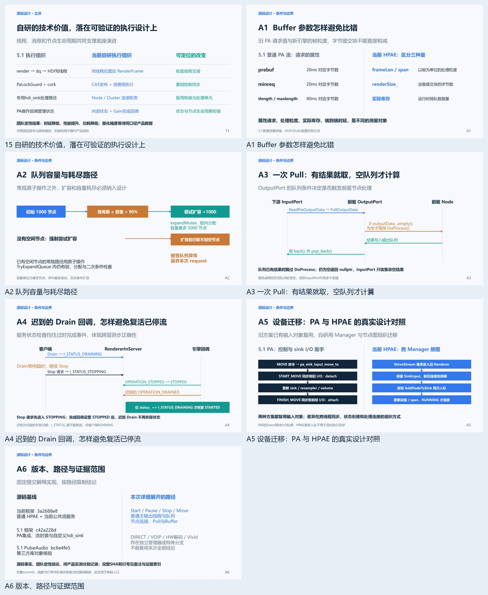

# 鸿蒙音频底座技术分享

这里保存《一段声音的旅程——鸿蒙音频底座的协同与自研演进》的可编辑材料和逐页技术重构记录。

> 2026-10-20教学深度重审：上一轮的正确性/图面PASS不足以支持55分钟授课。当前主讲材料估计仅支持24–32分钟，仍需试讲校准。正在逐页重做教学内容；P01已改为30–45秒开场。既有完整PPTX保留为历史发布版，不代表教学密度问题已解决。详见[全页审查](hongmeng_audio_design_review/reviews/TEACHING_DEPTH_AUDIT.md)及[单页修订](hongmeng_audio_design_review/逐页修订/P01_30秒开场.pptx)。

- [`IMPLEMENTATION_NOTES.md`](IMPLEMENTATION_NOTES.md)：已确认提纲、技术边界和制作进度。
- [`hongmeng_audio_foundation/`](hongmeng_audio_foundation/)：上一轮完整可编辑 PPTX、讲稿、预览、演示音频和源码证据，是可回溯基线。
- [`hongmeng_audio_design_review/`](hongmeng_audio_design_review/)：当前技术深化版，21页已逐页重写、渲染、复审并逐页推送。15页主讲与6页附录包含真实Start/Move时序、Pause/Stop状态机、CAS发布与批次消费、Buffer拼帧和PA/HPAE对照。
- [`SPEC.md`](SPEC.md)：原始需求文档。具体技术断言应以页面证据和固定源码版本为准。

本仓库不包含 OpenHarmony 源码完整镜像、依赖缓存及临时构建文件。幻灯片中的团队定性收益与可从公开源码核验的机制分开表述，尚未提供的量化性能数据不作推断。

## 当前交付入口

- [可编辑PPTX](hongmeng_audio_design_review/鸿蒙音频底座_技术深化版.pptx)
- [完整讲稿](hongmeng_audio_design_review/speaker_notes.md)
- [全部页面预览与逐页讲稿](hongmeng_audio_design_review/全部页面预览.html)（下载目录后离线打开）
- [源码与结论索引](hongmeng_audio_design_review/sources_and_claims.md)
- [本轮逐页审查](hongmeng_audio_design_review/REVIEW_SUMMARY.md)
- [构建与维护](hongmeng_audio_design_review/build/README.md)

源码核验范围固定为当前框架、5.1框架和5.1第三方PA。旧PA同样复用输入对象；新旧差异以同步边界、执行线程和处理图组织为准。

