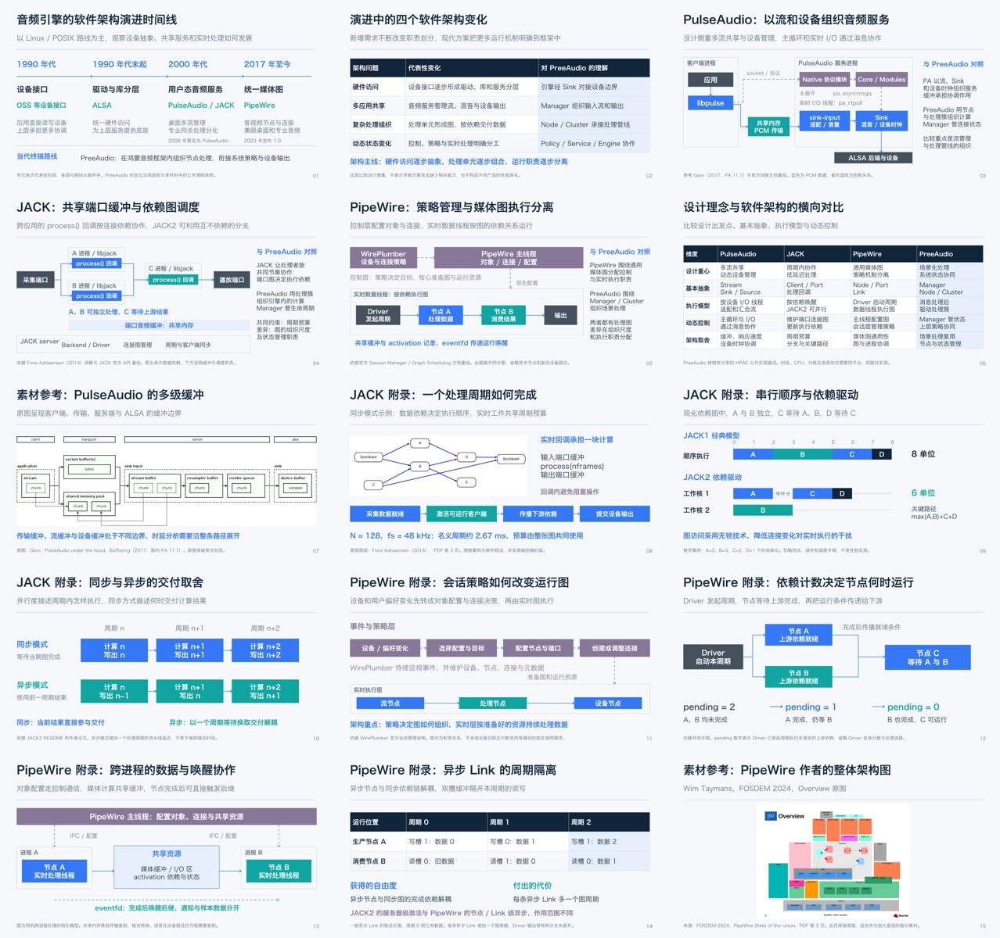

# 音频引擎演进与架构对比补充稿

独立 15 页、16:9、中文可编辑 PPT，可选择页面合并到主分享中。对比聚焦设计理念、核心抽象、调度模型和架构取舍。

- [最新版 PPT](output/PreeAudio_补充分享_JACK与PipeWire架构详解.pptx)
- [逐页口语讲稿和引用](speaker_notes.md)
- [逐页内容与技术名词解释](逐页内容与技术名词解释.md)
- [讲稿结构化源文件](narration.json)
- [资料来源](sources.md)
- [全部页面预览](previews/)
- [重建脚本](build/build_deck.mjs)

## 内容

| 页码 | 内容 |
|---|---|
| 1–2 | 音频引擎发展时间线和软件架构演进 |
| 3–6 | PulseAudio、JACK、PipeWire 与 PreeAudio 的设计和架构对比 |
| 7 | PulseAudio 多级缓冲原图参考 |
| 8–10 | JACK 周期预算、串行/依赖调度、同步/异步交付 |
| 11–14 | PipeWire 会话策略、依赖计数、跨进程共享与唤醒、异步 Link |
| 15 | PipeWire 作者整体架构原图 |

主稿框图、时序示意与表格可编辑，外部原图为静态图片。PPT 备注与独立讲稿均为可直接讲述的口语正文；资料出处附在各页正文之后。另附逐页原理说明、术语定义与计算示例。PreeAudio 依据既有分享固定的公开 HPAE 源码快照，不表示内部产品部署配置；教学周期与关键路径算例不属于性能实测。



## 重建

使用 Codex presentations 技能提供的 Node.js、`@oai/artifact-tool` 和最终校验工具。需要安装 Hiragino Sans GB 字体；其它环境可在脚本中明确调整字体后重新核对排版。

```sh
export RUNTIME_NODE_MODULES=/path/to/runtime/node_modules
export PRESENTATIONS_SKILL_DIR=/path/to/presentations/skill
export RUNTIME_PYTHON=/path/to/runtime/python3
ln -s "$RUNTIME_NODE_MODULES" build/node_modules
node build/build_deck.mjs
```

默认输出 `output/rebuilt.pptx`，保留发布版。最终校验器拒绝覆盖已有输出和校验报告；后续重建可设置新的 `FINAL_PPTX` 与 `VALIDATION_RECEIPT`。运行环境及依赖缓存不包含在仓库中。
