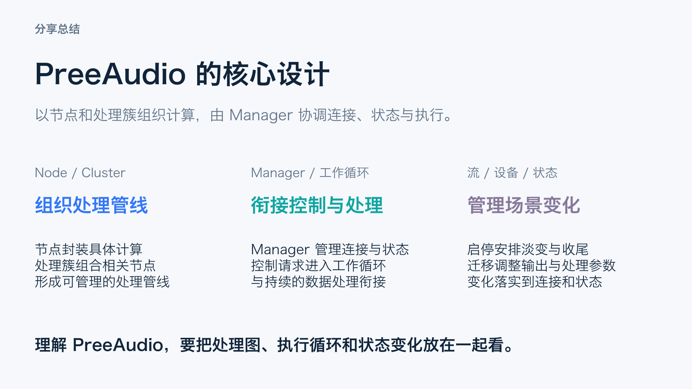

# PreeAudio 引擎总结页

独立一页、16:9、可编辑，适合合入主分享结尾。

- [总结 PPT（含口语讲稿备注）](PreeAudio_分享总结_引擎设计版.pptx)
- [独立讲稿及源码出处](speaker_notes.md)
- [页面预览](preview.png)

总结聚焦引擎自身：Node / Cluster 组织处理管线，Manager 衔接控制与处理，以及流、设备和状态变化的管理。

